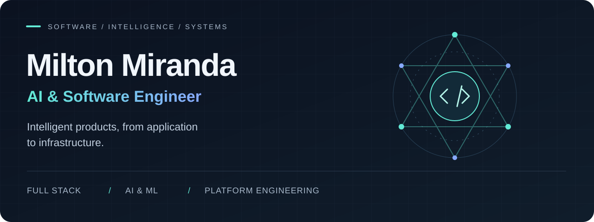
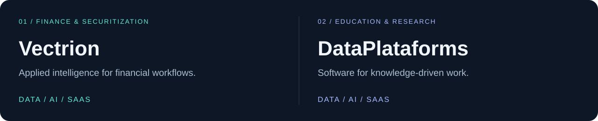

  

  <strong>Full Stack · DevOps · MLOps · Observability · LLM Engineering · Machine Learning</strong>

  <a href="#ecosystems">Ecosystems</a> &nbsp; / &nbsp;
  <a href="#application-portfolio">Applications</a> &nbsp; / &nbsp;
  <a href="#engineering-toolkit">Toolkit</a> &nbsp; / &nbsp;
  <a href="https://github.com/milton-miranda?tab=repositories">Repositories ↗</a>

## Engineering intelligent products, end to end.

I'm **Milton Miranda**, an engineer working across software development, artificial intelligence and platform operations. I build applications that connect data and machine learning with practical workflows in healthcare, finance, education, research and industry.

My work spans **full-stack applications, LLM-powered decision support, machine learning, DevOps, MLOps and observability**. I bring these disciplines together to develop AI-enabled products and SaaS ecosystems.

## Ecosystems

### Vectrion · Finance & Securitization

An ecosystem of data and AI-enabled SaaS applications for finance and securitization, bringing software engineering and applied intelligence into financial workflows.

### DataPlataforms · Education & Research

An ecosystem of data and AI-enabled SaaS applications focused on education and research, connecting digital platforms with knowledge-driven work.

## Application portfolio

Selected applications I have worked on across healthcare, personal care, education, research and industrial analytics.

| Domain | Application | Focus |
| :--- | :--- | :--- |
| **Healthcare / LLMs** | Clinical decision support | LLM-assisted diagnostic support for clinical decision-making. |
| **Healthcare / Imaging** | Medical image analysis | Applications supporting image-based diagnosis. |
| **Health / Wearables** | Smartwatch-based health analysis | Diagnostic support using data from smartwatches. |
| **Neurocognition** | Neurocognition platform | Software applications for neurocognitive workflows. |
| **Education** | Education platform | Digital applications for teaching and learning. |
| **Industry / Statistics** | Industrial reliability platform | Reliability and statistical analysis for industrial tools. |
| **Research** | Systematic review platform | Software supporting systematic literature review workflows. |

## Engineering toolkit

**Languages**  
`Python` · `C` · `C++` · `Go` · `Java`

**Web & application development**  
`Node.js` · `Next.js` · Frontend development · Full-stack engineering

**AI & machine learning**  
LLM engineering · Machine learning · AI application development · MLOps

**Infrastructure & operations**  
DevOps · Observability

---

### Let's build useful AI and dependable software.

Interested in international opportunities across **AI Engineering, Machine Learning, Full-Stack Development and Platform Engineering**.

[Explore my repositories →](https://github.com/milton-miranda?tab=repositories)

<!-- Add verified professional contact links here: LinkedIn, portfolio and/or email. -->
<!-- Add project URLs, individual responsibilities and measured results when available. -->

